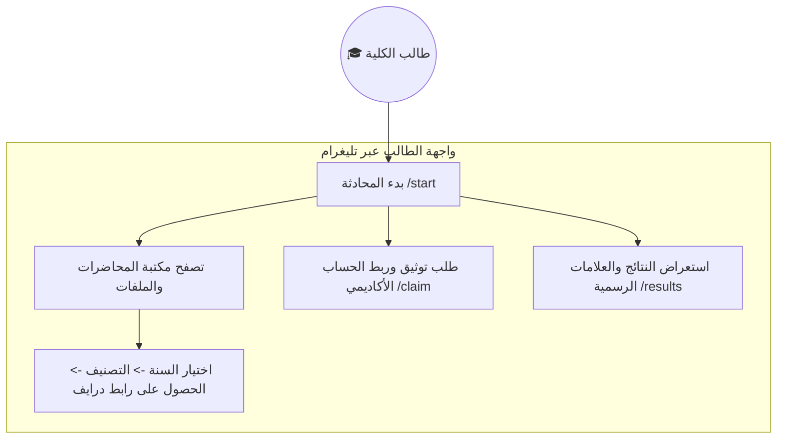
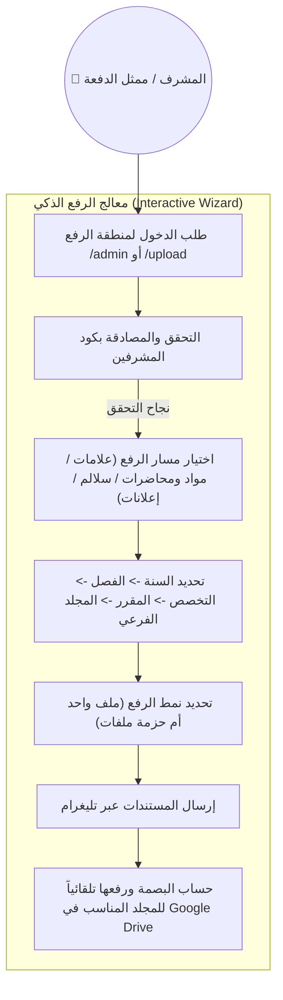
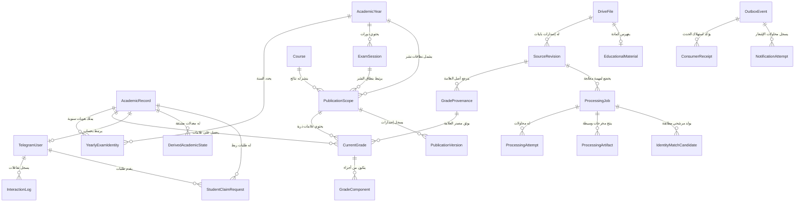
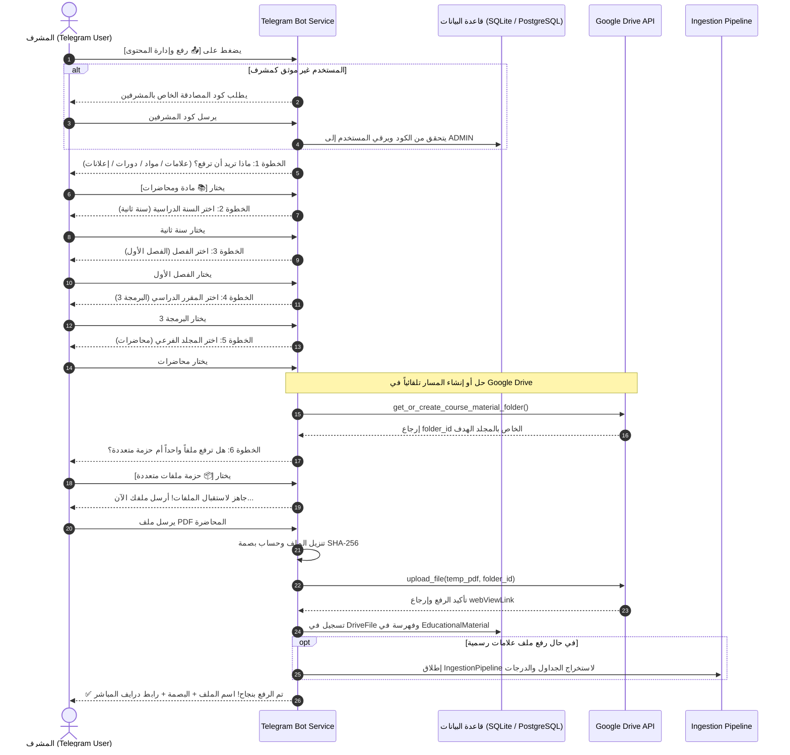

# المعمارية الشاملة وتطبيقات النظام — منصة "فهيم" (System Architecture & Apps Reference)

**الإصدار:** v2.0 · Production-Grade Architecture  
**المنصة:** فهيم (Faheem) — منظومة إدارة المحتوى التعليمي والعلامات الرسمية بكلية الهندسة المعلوماتية، جامعة دمشق  
**النمط الهندسي:** Modular Monolith (Clean Architecture & Service Layer)  

---

## 1. نظرة عامة على تطبيقات النظام (`apps/`)

يتألف النظام من 5 تطبيقات رئيسية مستقلة ومنظمة بعناية وفق مبادئ **Clean Architecture** ونمط **Service-Layer**:

```text
FaheemBE/project/apps/
├── academic/       # النواة الأكاديمية وسجلات الطلاب والعلامات ونطاقات النشر الذري
├── drive_sync/     # التكامل الكامل مع Google Drive ومكتبة المحاضرات وزاحف RBCs
├── ingestion/      # خط معالجة واستخراج الـ PDF والمطابقة وتطبيع النصوص العربية
├── telegram_bot/   # واجهة التفاعل الكاملة للطالب والإدارة ومعالج الرفع الذكي (Wizard)
├── operations/     # نمط الصندوق الصادر الموثوق (Transactional Outbox) والأحداث
└── api/            # المجمع المركزي لواجهات الـ REST API (/api/v1/...)
```

### تفصيل أدوار التطبيقات:
1. **`apps.academic` (النواة الأكاديمية):**
   - **النماذج:** `AcademicRecord`, `YearlyExamIdentity`, `Course`, `AcademicYear`, `ExamSession`, `PublicationScope`, `CurrentGrade`, `GradeComponent`, `GradeProvenance`, `PublicationVersion`, `DerivedAcademicState`.
   - **المسؤولية:** الحفاظ على الثوابت الأكاديمية وقفل نطاق النشر الذري وتتبع أصل كل علامة (Provenance) ومنع استبدال العلامات دون سند قطعي.
2. **`apps.drive_sync` (التكامل مع Google Drive والمحتوى التعليمي):**
   - **النماذج:** `DriveFile`, `SourceRevision`, `SourceMetadataObservation`, `EducationalMaterial`.
   - **المسؤولية:** الاتصال المباشر بـ Google Drive API عبر Service Account، إنشاء المجلدات وفق شجرة الكلية الرسمية، رفع وتنزيل الملفات، وزحف محاضرات منصة RBCs.
3. **`apps.ingestion` (خط معالجة العلامات):**
   - **النماذج:** `ProcessingJob`, `ProcessingAttempt`, `ProcessingArtifact`, `IdentityMatchCandidate`.
   - **المسؤولية:** تحليل ملفات الـ PDF بواسطة PyMuPDF، تطبيع الأسماء العربية واستخراج الأرقام الامتحانية والدرجات، وتقديم مقترحات مطابقة موثقة بدون سلطة كتابة مباشرة في العلامات الرسمية.
4. **`apps.telegram_bot` (واجهة تليغرام ومعالج الرفع التفاعلي):**
   - **النماذج:** `TelegramUser`, `StudentClaimRequest`, `InteractionLog`.
   - **المسؤولية:** توفير واجهة محادثة ذكية للطلاب للاستعلام عن المواد والعلامات، ومعالج رفع تفاعلي خطوة بخطوة للمشرفين (Upload Wizard) مربوط مباشرة بالدرايف.
5. **`apps.operations` (الصندوق الصادر وإدارة العمليات):**
   - **النماذج:** `OutboxEvent`, `ConsumerReceipt`, `NotificationAttempt`.
   - **المسؤولية:** ضمان التسليم الموثوق للإشعارات والأحداث بشكل ذري مع حفظ العلامات (Transactional Outbox) وتفادي التكرار.

---

## 2. مخطط حالات الاستخدام (Use Case Diagrams)

### أ. رحلة الطالب (Student User Flow)


### ب. رحلة المشرف ورفع المحتوى (Admin Upload & Management Flow)


---

## 3. مخطط الكيانات والعلاقات الكامل (Entity Relationship Diagram - ERD)



---

## 4. تدفق عملية الرفع التفاعلية عبر التليغرام نحو درايف (Sequence Diagram)

يوضح هذا المخطط تسلسل العمليات الكامل عند قيام مشرف برفع محاضرة أو ملف علامات عبر البوت التفاعلي:



---

## 5. الخلاصة وضمانات الجودة

- **حماية البيانات والأصل:** لا يتم اعتماد أي علامة أو رفع أي ملف دون حساب بصمة الـ SHA-256 الدقيقة لضمان عدم تلف الملفات أو تكرارها.
- **التدرج في الصلاحيات:** قنوات الاستعلام متاحة لجميع الطلاب، في حين أن مسارات الرفع والقرارات الأكاديمية محصورة بالمشرفين الموثقين.
- **المرونة:** تم بناء النظام ليعمل بكفاءة فائقة على أجهزة التطوير المحلية (باستخدام SQLite و Long-Polling)، كما أنه جاهز بنسبة 100% للنشر السحابي في بيئات الإنتاج (PostgreSQL و Webhooks).
